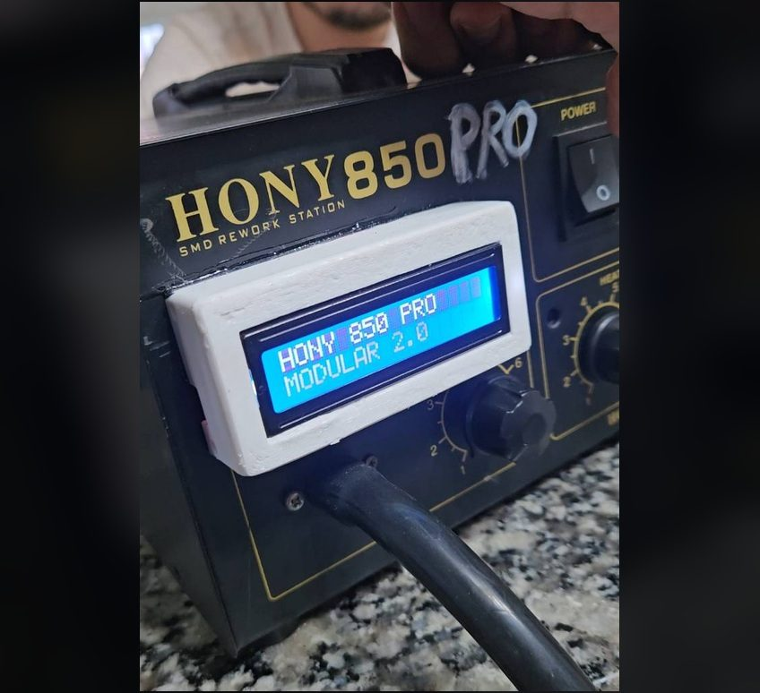

# Hony 850 Pro — Digital hot-air rework station retrofit

**Real Hony 850 prototype retrofitted with an Arduino Nano, PID temperature control, original diaphragm pump and modular V2.0.5 firmware.**

[Español](README.md) · [Build / verification (Spanish)](docs/BUILD_ES.md) · [12-page schematic (PDF)](hardware/Hony850Pro_Esquematico_Conexiones_Completas_V2_0_5.pdf) · [Firmware](firmware/current/Hony850Pro_Nano_Modular_v2_0_5) · [Parts list](bom/BOM.csv)

> [!WARNING]
> **Experimental, not a certified or generally safe mains-powered design.** The heater operates around 650 W / 220 VAC. The full V2.0.5 software has not been verified on the actual unit; prior V2.0.2 was reported to work during basic physical testing. Mains-stage values and some physical connections are still unconfirmed.

| Block | Hardware |
|---|---|
| MCU | Arduino Nano / ATmega328P 16 MHz |
| UI | 16×2 I²C LCD and two rotary encoders |
| Temperature | Type K thermocouple and MAX6675 |
| Zero-cross | H11AA1 at D2 |
| Pump | Original Hony diaphragm pump; MOC3023 + TRIAC phase control at D3 |
| Heater | Adapted Yihua ~74.9 Ω ceramic heater; MOC3083/BTA12 and relay at D4/D5 |
| Software | PID, EEPROM, 3-cycle autotune, watchdog, preflow, cooldown, fault handling |

**Permanent scope decision:** no airflow sensor / flow meter will be added. AIR percentages represent the pump control command and **do not measure physical airflow**. The hardware design will not rely on fictional flow feedback.

### Reproduce / inspect

1. Read [safety limitations](docs/safety.md) and [actual vs. unconfirmed wiring](hardware/WIRING_ES.md).
2. Consult [parts list](bom/BOM.csv), [pin mapping](hardware/pinout-reference.csv), [real photos](docs/photos/README.md) and [schematic](hardware/Hony850Pro_Esquematico_Conexiones_Completas_V2_0_5.pdf).
3. Open the complete Arduino sketch folder in [firmware/current](firmware/current/Hony850Pro_Nano_Modular_v2_0_5); use Arduino Nano ATmega328P, `hd44780` and compatible `max6675.h` libraries.
4. Verify the low-voltage controls **with heater mains physically disconnected** before testing any power stage.
5. Follow the [commissioning checklist](docs/COMMISSIONING_ES.md). Do not assume that firmware timers prove a pump is moving air or that an off command proves the heater was disconnected.

A source license has not yet been selected; this is a public technical record, not an automatic unrestricted re-use grant. Maintainer: **Facundo David Gileno / PC Service Computación**.
