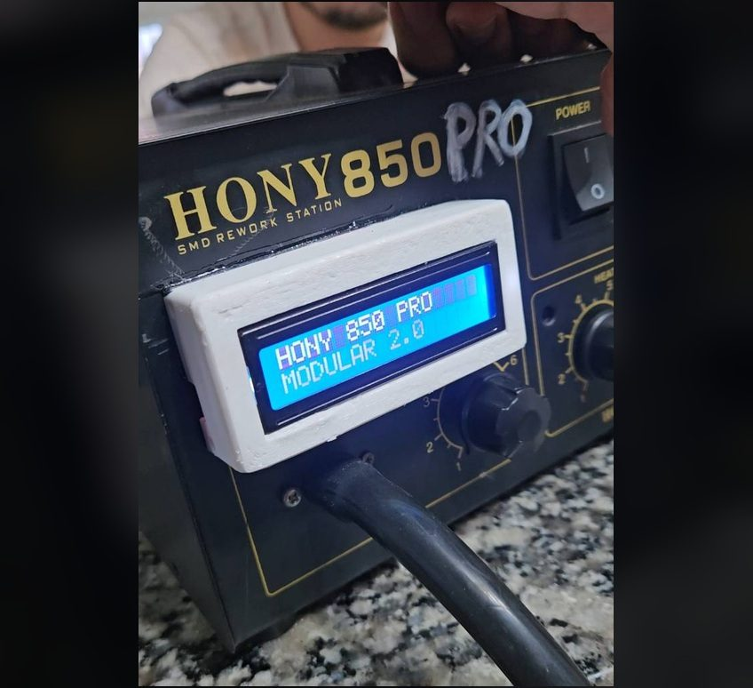
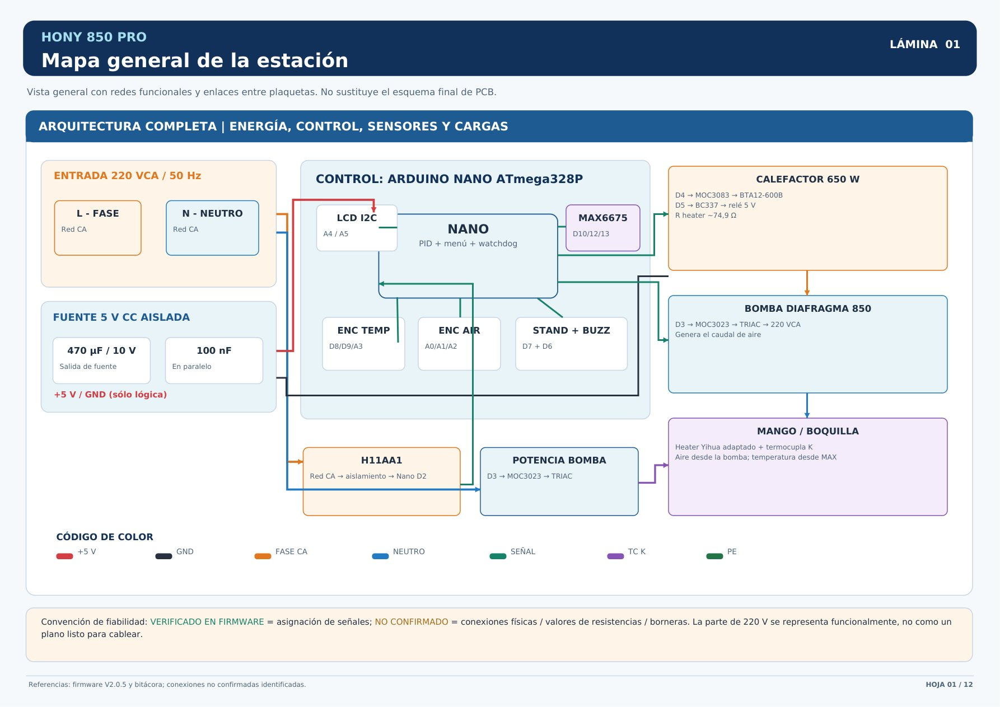

# Hony 850 Pro

## ESP32-S3 — primera versión de referencia estable (V3.4.2)

La plataforma vigente es **ESP32-S3 V3.4.2**, declarada estable por el autor el 22/11/2026. [Firmware ESP32](firmware/esp32/Hony850Pro_ESP32S3_v3_4_2) · [Diagrama de conexiones SVG](hardware/esp32-s3-wiring-v3.4.2.svg) · [Pinout real](hardware/esp32-s3-pinout-stable.md) · [Release notes](docs/releases/esp32-v3.4.2.md).

**GPIO reales:** LCD SDA/SCL 1/2; ZC 4; bomba 5; calefactor 6; relé 7; buzzer 8; stand 9; TEMP 10–12; AIR 13–15; MAX6675 16–18. **No utilizar el pinout Nano para el ESP32.**

Se conservan tres canales NVS, FAST HEAT, TEMP corto para alternar calor/solo aire y reactivación por stand. `HONY_ENABLE_MAINS_OUTPUTS=1` según decisión del autor. Estabilidad es designación de baseline del proyecto, **no homologación ni ensayo independiente**. No existe ni se incorporará sensor de caudal o de paso de aire.

## Historial del proyecto: Arduino Nano V2.0.5

**Modernización digital de una estación de aire caliente Hony 850 con Arduino Nano, control PID y documentación del prototipo real.**

[English](README.en.md) · [Construcción y verificación](docs/BUILD_ES.md) · [Esquema eléctrico V2.0.5](hardware/Hony850Pro_Esquematico_Conexiones_Completas_V2_0_5.pdf) · [Conexiones](hardware/WIRING_ES.md) · [Componentes](bom/BOM.csv) · [Firmware](firmware/current/Hony850Pro_Nano_Modular_v2_0_5) · [Historial](CHANGELOG.md)

Fotografía del montaje real. Más imágenes en <a href="docs/photos/README.md">galería</a>.

> [!WARNING]
> **PROTOTIPO EXPERIMENTAL. NO ES UN EQUIPO CERTIFICADO.** Hay tensión de red de 220 V y un calefactor de aproximadamente 650 W. El firmware V2.0.5 todavía no está validado integralmente en el banco. No interpretar diagramas funcionales ni simulaciones como prueba de aislamiento, corte físico ni protección contra incendios. Consultar [seguridad y límites](docs/safety.md) antes de trabajar con cualquier parte de potencia.

**Estado al 19-11-2026:** la versión **V2.0.2 fue probada físicamente en funcionamiento normal**; la **V2.0.5 es la última revisión de código**, con pruebas lógicas de escritorio y cambios de interfaz/autotune **pendientes de validación física integral**. Esta publicación documenta lo realizado y lo que aún debe verificarse; no es una versión comercial segura.

## Qué construí

Convertí mi Hony 850 analógica en una estación de aire caliente con regulación digital de temperatura, control de la bomba original, pantalla LCD, dos encoders, sonda termopar K, PID y protecciones de software. Mantengo el gabinete y la bomba de diafragma y adapté un calefactor cerámico Yihua 8786D de ~74,9 Ω (potencia nominal calculada ~646 W a 220 V).

| Subsistema | Implementación documentada |
|---|---|
| Control | Arduino Nano ATmega328P, 5 V / 16 MHz |
| Pantalla | LCD 16×2 I²C PCF8574, botones y encoders AIR/TEMP |
| Temperatura | Termocupla tipo K + MAX6675 |
| Sincronización | H11AA1 → interrupción D2 |
| Calefactor | MOC3083 + BTA12-600B + relé 5 V (mando D4/D5) |
| Bomba | Diafragma original, MOC3023 + TRIAC, disparo D3/Timer1 |
| Stand | Microswitch para mango apoyado (D7) |
| Firmware | V2.0.5 modular: PID, EEPROM, autotune 3 ciclos, watchdog, preflujo y cooldown |

> **Decisión de diseño definitiva:** el proyecto **no incorpora ni incorporará sensores de caudal o de paso de aire**. `AIR %` es únicamente una consigna de accionamiento de la bomba, **no una lectura de flujo físico**. No se presenta esa consigna como protección contra pérdida de aire. Las revisiones futuras se centran en calibración, robustez del control y seguridad térmica y eléctrica independiente.

## Cómo reproducir el proyecto

1. Leer la [guía de seguridad](docs/safety.md) y el [alcance del esquema](hardware/WIRING_ES.md): las partes de 220 V requieren verificación competente antes de cablear.
2. Revisar la [BOM](bom/BOM.csv) y las [fotografías del montaje real](docs/photos/README.md); las piezas y valores no confirmados están identificados y **no deben completarse por suposición**.
3. Consultar el [esquema V2.0.5 de 12 hojas](hardware/Hony850Pro_Esquematico_Conexiones_Completas_V2_0_5.pdf), el [pinout CSV](hardware/pinout-reference.csv) y las [conexiones de baja tensión](hardware/WIRING_ES.md).
4. Abrir el archivo `.ino` dentro de la [carpeta de firmware completa](firmware/current/Hony850Pro_Nano_Modular_v2_0_5) usando Arduino IDE. No separar el `.ino` de los `.cpp`/`.h`.
5. Seleccionar Nano ATmega328P a 16 MHz. Instalar `hd44780` de Bill Perry y biblioteca `MAX6675` compatible; `Wire` y `EEPROM` vienen con el core AVR. Ver [guía del firmware](firmware/README.md).
6. Comprobar **primero únicamente la lógica a 5 V con la potencia calefactora físicamente desconectada**: LCD, controles, sensor, stand y autodiagnósticos. No aplicar 220 V como primer test.
7. Seguir [puesta en marcha y checklist](docs/COMMISSIONING_ES.md). No declarar segura una reconstrucción sin revisar protecciones físicas, puesta a tierra, aislamiento y desconexión efectiva del calefactor.

Las instrucciones proporcionan la arquitectura, los pines, el firmware y evidencias existentes, pero **no un procedimiento de cableado de 220 V listo para ejecutar sin revisión**. Se deben medir o confirmar las resistencias de disparo, configuración de la red CA, protección contra sobretemperatura, relé y conexiones no determinadas.

## Vista general

[Ver las 12 hojas completas del esquema](hardware/Hony850Pro_Esquematico_Conexiones_Completas_V2_0_5.pdf) · [Asignación de pines](hardware/pinout-reference.csv)

## Documentación y archivos

| Sección | Contenido |
|---|---|
| [firmware/current](firmware/current/Hony850Pro_Nano_Modular_v2_0_5) | **25 archivos originales V2.0.5**; código modular y pruebas descritas |
| [hardware](hardware) | Esquema V2.0.5, cableado y pinout, con grado de verificación |
| [bom](bom/BOM.csv) | Lista de materiales con instalado / reportado / por confirmar |
| [docs/BUILD_ES.md](docs/BUILD_ES.md) | Descripción de la construcción, sin inventar valores de red |
| [docs/COMMISSIONING_ES.md](docs/COMMISSIONING_ES.md) | Checklist de diagnóstico y validación |
| [docs/photos](docs/photos/README.md) | Fotografías reales de resistencia, interior y estación |
| [docs/academic](docs/academic) | Carpeta de campo y presentación final (editables y PDF) |
| [docs/tests-and-results.md](docs/tests-and-results.md) | Resultados declarados, límites de evidencia, pruebas pendientes |
| [docs/thermal-calibration.md](docs/thermal-calibration.md) | Factor 0,68, PID y mediciones de referencia |
| [docs/roadmap.md](docs/roadmap.md) | Mejoras futuras **sin sensores de caudal** |
| [CHANGELOG.md](CHANGELOG.md) | Hitos y versiones históricas |

## Interfaz actual

- **TEMP girar:** temperatura de 80–360 °C corregidos, de 5 en 5 °C.
- **TEMP toque:** encendido/parada de calefacción y cooldown.
- **AIR girar:** consigna de bomba 0–100 %; se exige al menos 20 % para habilitar calor.
- **AIR mantener:** abre menú PID. **AIR toque = volver** y **TEMP toque = aceptar**.
- **Autotune:** tres ciclos; sólo con calefacción previa apagada y condiciones comprobadas por software. La excepción de stand en autotune **no implica seguridad física validada**.
- **Cooldown:** hasta 100 °C RAW, con histéresis a 110 °C RAW; no equivale a una temperatura real de boquilla de 100 °C.

## Equipo y colaboradores

El proyecto Hony 850 Pro cuenta con los siguientes colaboradores acreditados:

- **Mauro Iván Redka**
- **Tomás Saldaña**
- **José Benjamín Vera**
- **Luca Vega**
- **Santiago Giménez**

**Autor del prototipo y responsable del repositorio:** Facundo David Gileno / PC Service Computación.

Los créditos identifican a las personas indicadas por el autor; no asignan responsabilidades técnicas individuales ni implican permisos de acceso a GitHub. Ver [equipo y créditos completos](CONTRIBUTORS.md).

## Autoría y licencias

Autor del prototipo: **Facundo David Gileno / PC Service Computación**. La publicación mantiene la trazabilidad de las versiones antiguas y el estado experimental. **No hay una licencia de reutilización aprobada para este repositorio todavía**: que el código sea visible públicamente no significa automáticamente que se concedan todos los permisos de redistribución comercial. [Estado de licencias y contribuciones](CONTRIBUTING.md).
