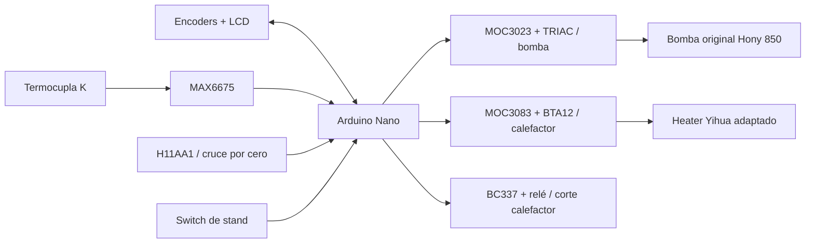

# Arquitectura técnica V2.0.5

El Nano ATmega328P orquesta cinco grupos de tareas: UI, lectura térmica MAX6675, PID del calefactor, control de fase de la bomba y supervisión de estados/errores. [Archivos de código](../firmware/current/Hony850Pro_Nano_Modular_v2_0_5) · [Esquema de referencia](../hardware/Hony850Pro_Esquematico_Conexiones_Completas_V2_0_5.pdf).

### Características calculadas / programadas

- Resistencia Yihua medida ~74,9 Ω: `220² / 74,9 ≈ 646 W`, a tensión nominal. El cálculo no informa de temperaturas reales de trabajo.
- Regla térmica empírica: `T_indicada ≈ 0,68 × T_RAW`; los umbrales de seguridad RAW **no** deben escalarse.
- Intervalo de consigna corregida 80–360 °C, paso 5 °C; objetivo PID en RAW `consigna / 0,68`.
- PID referencia Kp 1,994; Ki 0,168; Kd 1,707. EEPROM sólo después de autotune válido.
- MAX muestreo cada 250 ms, PID cada 250 ms, watchdog 500 ms; preflujo de tres segundos.
- Comando AIR = porcentaje de disparo de bomba; **sin medición física de flujo, y sin proyecto de agregar sensor**.

### Estados y excepciones

En calefacción normal, el stand veta el mando de potencia. El autotune habilita una excepción explícita y temporal mientras se ejecuta, la revoca al salir y siempre debe ensayarse físicamente. Cooling hasta 100 °C RAW; rearme desde 110 °C RAW si las condiciones lo requieren. El watchdog y el detector de cruce por cero reducen ciertos fallos de software, **pero no sustituyen una protección térmica independiente ni un relé verificado**.

### Evidencia

V2.0.2: ensayo físico de funcionamiento normal reportado. V2.0.5: simulaciones de estados / compilación C++ host; compilación AVR real y validación integral en equipo pendientes. [Pruebas](tests-and-results.md).
