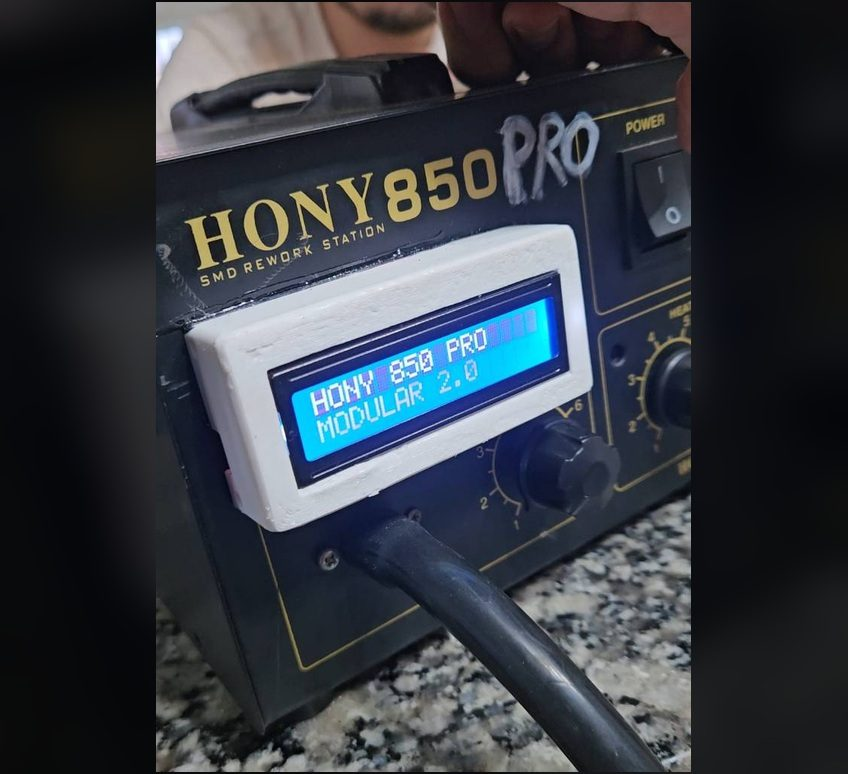
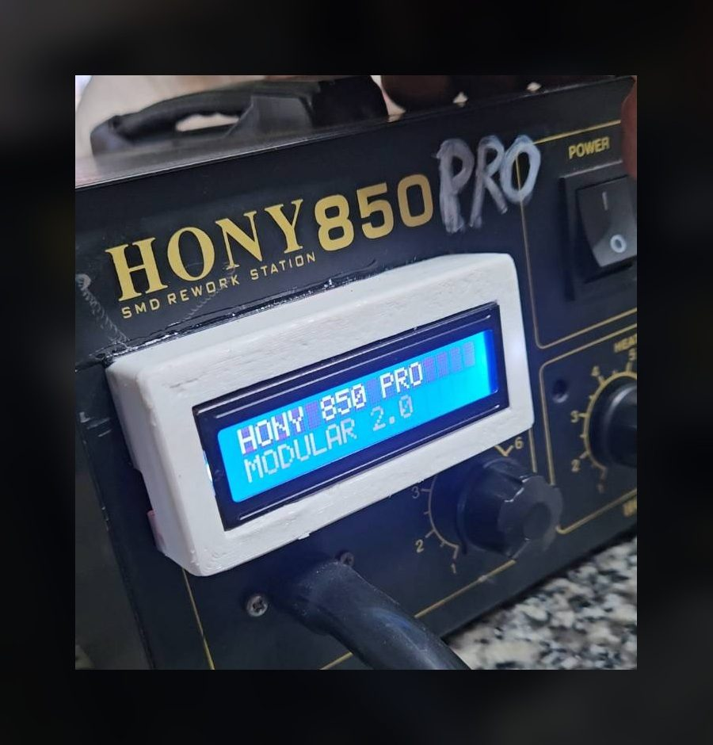

# Fotografías reales del prototipo

Imágenes extraídas de la presentación final. Son **fotografías del proyecto real**, no renders. Diferentes fotos corresponden a diferentes momentos de montaje; ninguna demuestra por sí sola que una conexión eléctrica sea correcta o que el circuito sea seguro.

| Imagen | Descripción |
|---|---|
| [Estación frontal](prototype-front.jpg) | Panel Hony 850 Pro, LCD instalado |
| [Primer calefactor y Yihua adaptado](heater-original-vs-yihua.jpg) | Comparación del primer intento / conjunto anterior con resistencia final que se terminó usando |
| [Interior](open-chassis.jpg) | Bomba, mangueras y cableado durante montaje |
| [Placa de control](controller-board.jpg) | Nano y componentes en placa de montaje |
| [Cableado y potencia](power-and-wiring.jpg) | Evidencia visual de placa y conexiones en proceso |
| [Cabezal](head-assembly.jpg) | Montaje del mango/boquilla adaptada |

